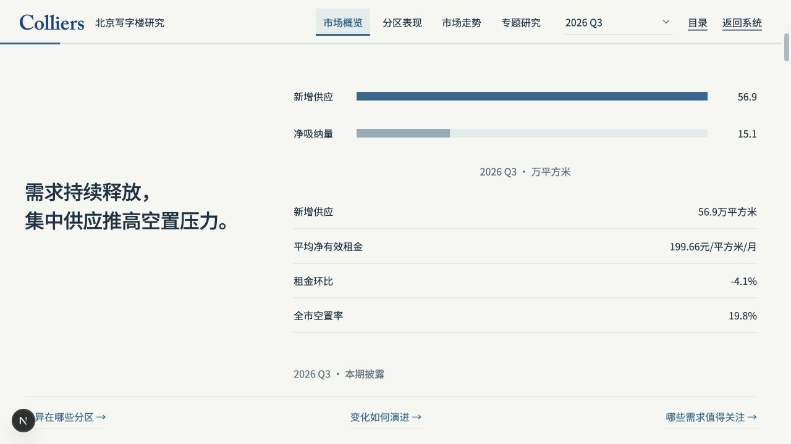
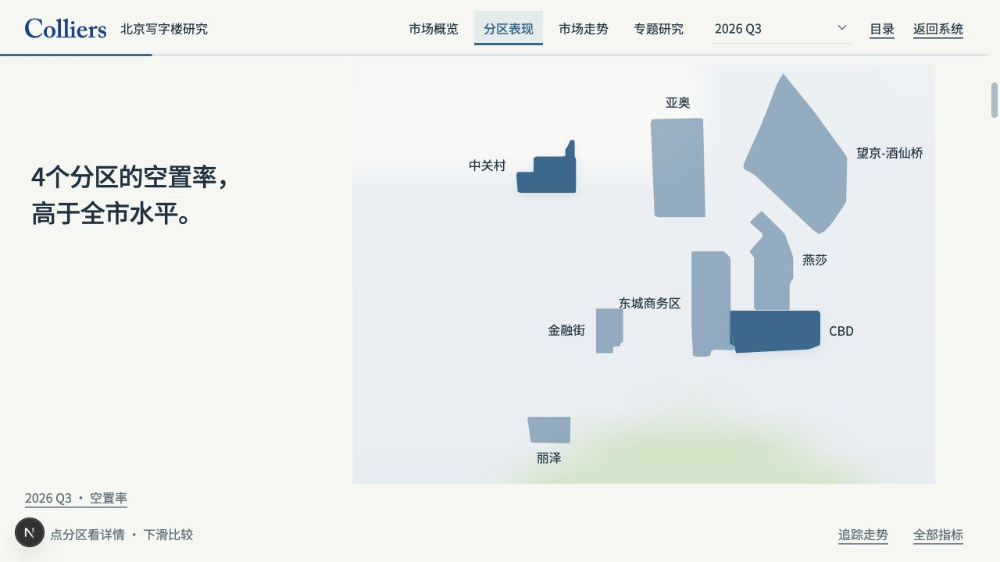
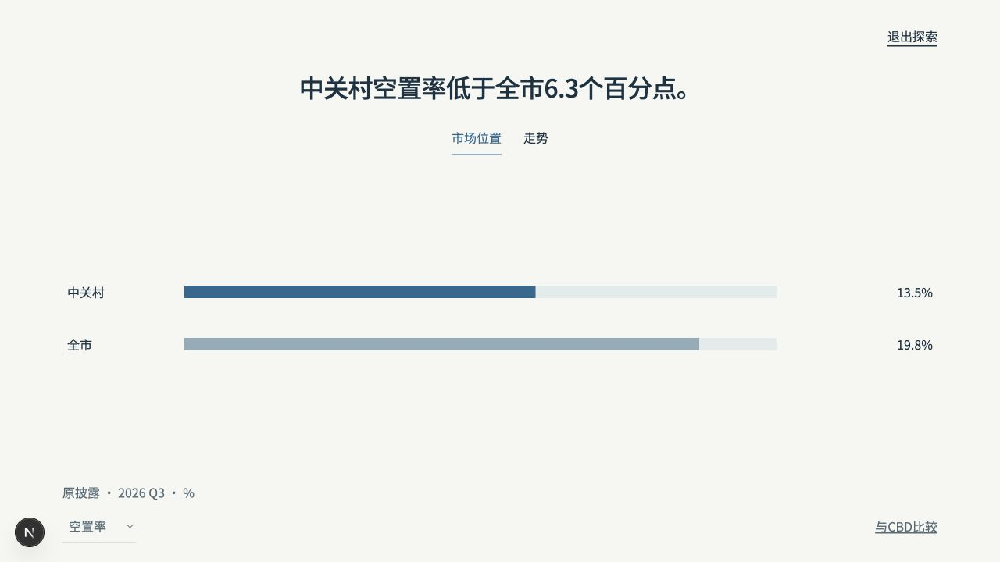
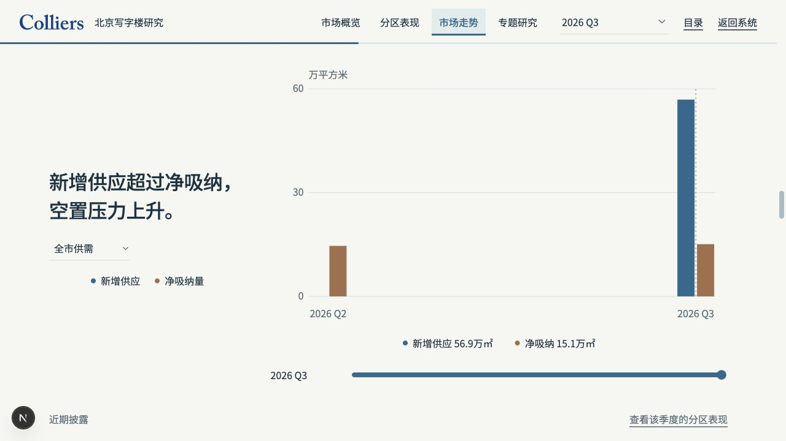
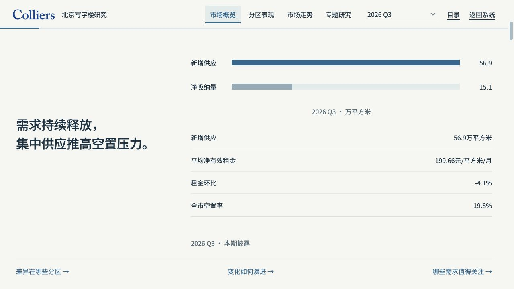
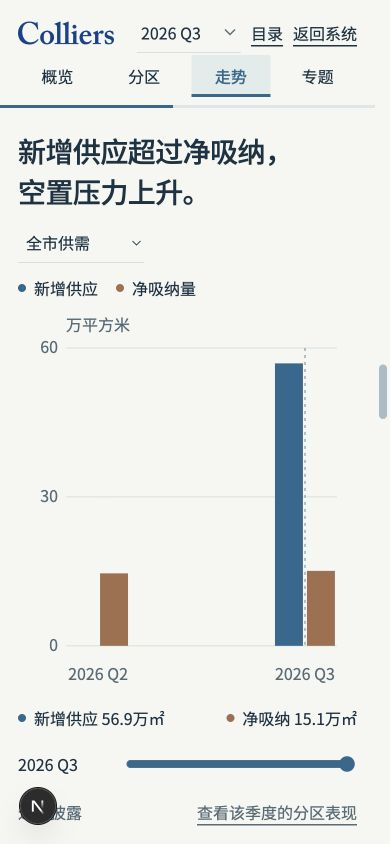
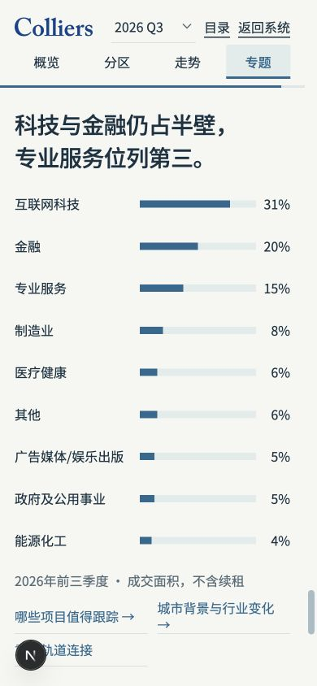

# 三季度研究上线复核

受检实现：55e8d4203f1ecbe09b062147aead279dbfa60d22。本文与图片的提交只补验证证据，未改变受检实现、报告HTML或交互脚本。基线为main 09f3807和已认可的二季度交互研究；季度接入是扩展，不是视觉重设计。

## 视觉与交互结论

限定桌面和手机视口：通过。主代理逐屏操作核对；Impeccable独立复核已检查8张画面，唯一轨道字段一致性问题修复并复核。二季度保留；三季度有独立观点与数据。后续取消加密仅改变服务端文件读取，正文与此前验收文件逐字一致，散点渐进标签、地图聚焦退出、章节切换、历史滑动、区域联动保持。

字体、字号、对齐、分组和默认信息密度延续既有规范：32/16两档、400/500两种常规字重，纸面背景及蓝／铜数据角色。下列为实际1280×736、390×844结果；手机项目长内容按正常滚动，不强塞固定屏。没有以截图替代动态操作。

## 权限与部署

生产构建在本机隔离认证下，两季度管理员200，editor/viewer403，匿名401，HTML静态直链404；详见production-build-access.json。客户端与服务端均验证角色，服务端拒绝模拟身份和强制改密状态，HEAD再次核对权限，退出账号移除内容。只读功能无数据库迁移。

Vercel dpl_8zGj1iRgs5XYwEQRz5RPuAM3Ekji 对应此实现且READY。READY不是管理员线上操作验收；Preview仍受Vercel认证保护，正式站登录态待用户提供。临时分享链接创建被自动审批拒绝，未执行；现有CLI账号也不属于目标团队，未通过其他方式扩大访问。

## 性能与手机边界

本机生产构建各20次重复加载无失败，桌面P90上界997ms，390px视口P90上界645ms。终点为真实报告入口可见；计时包含自动化通信开销。原始数据见loading-samples.json。应用壳为热缓存，报告本体no-store；不冒称冷缓存、真实手机或真实线上网络。首次反馈、完整冷/热条件与真机仍待验，因此VERIFY-06及MOB-05保持未完成。

本记录允许明确限定范围的视觉结论，不自动豁免手机与性能门槛。合并仍需精确head的Verify与Visual acceptance evidence通过，以及缺失门槛补齐或用户明确批准适用例外；不得把已授权上线解读成已完成验收。

## 主分支同步

主分支推进至cc5b920后，仅CHANGELOG出现同位置追加冲突，已保留双方记录；研究模块、首页研究入口、两季度HTML及其脚本与55e8d42逐字一致。同步后的本地测试204文件／1,304项通过，Lint 0错误／828警告；精确最终提交仍须独立取得远端CI。
